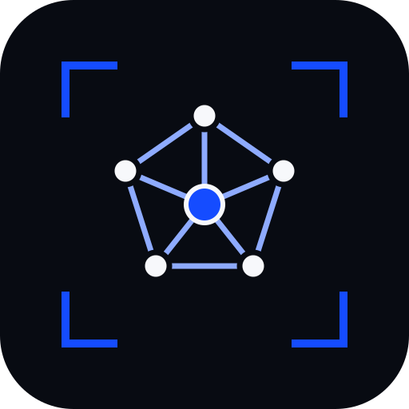
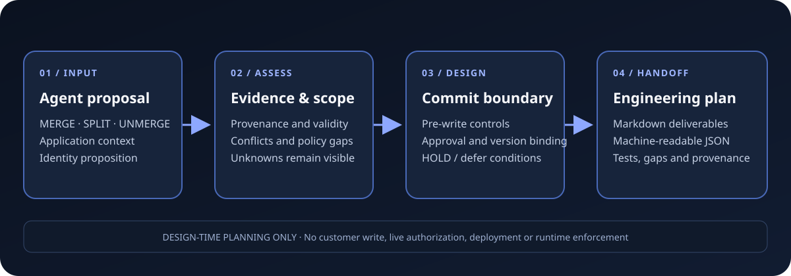

# Agentic Entity Resolution Guardrail Planner

  

**A confident entity match is not permission to merge.**

Agentic Entity Resolution Guardrail Planner helps engineering teams turn an AI-proposed identity change into a reviewable implementation plan: evidence requirements, conflict handling, approval conditions, commit-boundary controls, implementation guidance and validation scenarios.

It is designed for workflows where an agent proposes a persistent change to entity identity — especially **MERGE, SPLIT and UNMERGE** — in CRM, MDM, entity registries and knowledge graphs.

> **This is a design-time planning tool.** It does not execute a mutation, authorize a live operation, write to a customer system, deploy a runtime guard or guarantee safe production behaviour. The customer's application must implement and test the resulting controls.

## Get the product

The Agentic Entity Resolution Guardrail Planner is published on Agensi as a design-time Agent Skill.

[Open Agentic Entity Resolution Guardrail Planner on Agensi](https://www.agensi.io/r/DANIELBERANEK?to=/skills/agentic-entity-resolution-guardrail-planner)

## What it does

1. **Qualifies the operation** — identifies the identity-changing workflow and its scope.
2. **Examines evidence and conflicts** — separates identity evidence from similarity signals, records provenance and surfaces unresolved contradictions.
3. **Designs commit-boundary controls** — specifies the checks, approvals, version binding and HOLD conditions required before persistent writes.
4. **Produces an engineering handoff** — creates structured Markdown documents and a machine-readable JSON plan.
5. **Makes gaps explicit** — records unknowns, customer-owned decisions and validation that has not been performed.

## Example output

The [synthetic CRM MERGE demonstration](demo-for-agensi/README.md) contains the nine canonical planning artefacts generated by **Skill v0.4.0**. Release v0.4.1 aligns the Skill and package identifiers with the canonical product name; it does not change planning logic:

- [00 — Plan overview and validation record](demo-for-agensi/00-README.md)
- [01 — Mutation scope](demo-for-agensi/01-mutation-scope.md)
- [02 — Guardrail specification](demo-for-agensi/02-guardrail-specification.md)
- [03 — Evidence requirements](demo-for-agensi/03-evidence-requirements.md)
- [04 — Commit-boundary design](demo-for-agensi/04-commit-boundary-design.md)
- [05 — Implementation blueprint](demo-for-agensi/05-implementation-blueprint.md)
- [06 — Validation scenarios](demo-for-agensi/06-validation-scenarios.md)
- [07 — Assumptions and gaps](demo-for-agensi/07-assumptions-and-gaps.md)
- [Machine-readable guardrail specification](demo-for-agensi/guardrail-spec.json)

The example is synthetic. Its 31 customer-operation tests are proposed scenarios, not executed tests. The plan is explicitly marked **not implementation-ready** because customer policy, evidence, write-set, atomicity, approval and other decisions remain unresolved. Its validation record also identifies checks that were not run.

## Scope and limitations

**In scope:** agentic entity-resolution workflows that materially change persistent entity identity or identity-bearing relationships: MERGE, SPLIT, UNMERGE and supported identity-changing OTHER operations.

**Not in scope:** generic CRUD, general database security audits, automatic duplicate cleanup, runtime authorization, production execution, rollback services or compliance certification.

The planner does not decide legal identity or domain policy on the customer's behalf. Similarity scores, model confidence and generated labels are not substitutes for claim-specific evidence or authorization. When material evidence, scope, authority or commit-boundary facts are unknown, the plan should specify HOLD, defer or human review rather than invent an answer.

## Reference dependency

Reference-backed mode can use the public, read-only DIO/ODI Reference MCP:

- Endpoint: [mcp.danielberanek.cz/mcp](https://mcp.danielberanek.cz/mcp)
- Transport: Streamable HTTP
- The buyer connects the endpoint separately in a compatible agent/client.
- The MCP provides reference material; it does not receive customer records, inspect customer application state or authorize customer writes.

The product's design approach is informed by the conceptual paper [Constraining the Commit Boundary: A DIO/ODI-Informed Authorization Guardrail for Agentic Entity Resolution](https://arxiv.org/abs/2610.37407). The paper is a conceptual architecture. Buyers do not need prior knowledge of DIO/ODI.

## Canonical product identity

**Agentic Entity Resolution Guardrail Planner** is the single canonical product name. Its technical identifier is `agentic-entity-resolution-guardrail-planner`. The same identifier is used for the public repository slug, the Agent Skill `name`, the Skill package root directory, schema identifier namespaces, and the default output-directory prefix. The human-readable title is the display form of that same identity, not a second product name.

## Source and licensing

This repository is a public product overview and demonstration of generated planning outputs. It does **not** contain the paid Skill source, its internal references, templates or build system. No open-source licence is granted to the proprietary Skill by publication of this repository. The demonstration documents remain subject to the rights and terms stated by their author; do not assume a permissive licence.

## Links

- [Synthetic demonstration](demo-for-agensi/README.md)
- [Public DIO/ODI Reference MCP](https://mcp.danielberanek.cz/mcp)
- [Concept paper on arXiv](https://arxiv.org/abs/2610.37407)
- [Author website](https://danielberanek.cz/)
